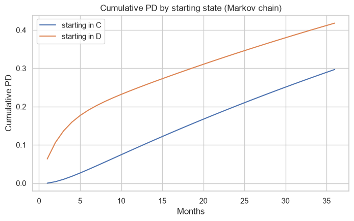

# IFRS 9 expected credit loss with Markov chains and macro scenarios

The expected credit loss (ECL) of a credit card portfolio, calculated the way IFRS 9 asks:
- the clients are classified in stages 1, 2 and 3;
- the 12-month and lifetime PD come from a Markov chain of the monthly delinquency states;
- the PD is made forward-looking with three macroeconomic scenarios through a satellite model.

**Data:**
- "Default of credit card clients" (UCI): 30.000 clients with 6 months of payment status.
- FRED: US unemployment (UNRATE) and the charge-off rate of credit cards (CORCCACBS).

## Method
1. A monthly transition matrix between the states current, delinquent and default, estimated with the payment history. Lifetime PD comes from the powers of the matrix.
2. A satellite model of the annual change in the charge-off rate (log-odds) on the change in unemployment: coefficient 0.172, t = 8.7. The 2020-2022 period is excluded (2020Q1 to 2022Q2): unemployment jumped but charge-offs fell, because of the stimulus checks and payment holidays.
3. Base, adverse (+2.5 points of unemployment) and upside (-0.5 points) scenarios, weighted 60/30/10.
4. LGD and EAD assumptions, documented in the notebook.

## Results
| | Stage 1 | Stage 2 | Stage 3 | Portfolio |
|---|---|---|---|---|
| Coverage (ECL / EAD) | 8.5% | 35.8% | 80% | 13.8% |

- **PD by state:**
  - A current client has a 12-month PD of 9.4% and a lifetime PD of 29.7%.
  - A client 1-2 months late has 24.9% and 41.8%.
- **ECL by scenario:** 416 million NTD in the base scenario, 558 in the adverse one and 391 in the upside one.
- **Weighted ECL:** the probability-weighted ECL (456) is above the base one. Losses are not linear in the scenarios, which is why IFRS 9 asks for several of them.
- **Limit:** the "default next month" of the dataset is any missed payment, not 90 days past due, so it cannot back-test the PD directly. The notebook explains it.



## How to run
```
pip install -r requirements.txt
jupyter notebook ifrs9_ecl.ipynb
```

---
Alejandro Lezcano Osorio | Rennes School of Business (MSc in Financial Data Intelligence) and Universidad EIA
